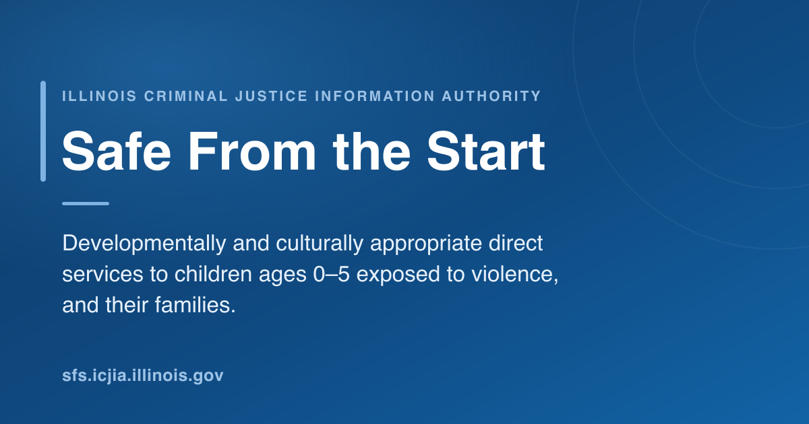

<p align="center">
  
</p>

# Safe From the Start (SFS)

[](./LICENSE)
[](https://astro.build)
[](https://tailwindcss.com)
[](https://www.fusejs.io)
[](https://nodejs.org)
[](https://pnpm.io)
[](https://sharp.pixelplumbing.com)

The Safe From the Start (SFS) program provides developmentally and culturally appropriate direct services to children, ages 0 – 5, who have witnessed or been exposed to violence and their families. SFS focuses on serving young children who are victims of abuse, neglect, or maltreatment, and/or witnesses to domestic violence, sexual assault, or other violent crimes.

**Live site:** https://sfs.icjia.illinois.gov/

## Stack

- **Framework:** Astro 7 (static SSG)
- **Styling:** Tailwind v4 via `@tailwindcss/vite`
- **Interactivity:** ~100 lines of vanilla DOM in `Layout.astro` (nav drawer,
  dropdowns, footer year) — no framework island, so the CSP carries no
  `'unsafe-eval'`
- **Content:** Astro Content Collections (markdown in `src/content/pages/`)
- **Search:** Fuse.js client island over a build-time JSON index (`/search` + `/search-index.json`)
- **SEO/AI:** `astro-seo` (OG/Twitter/canonical/hreflang), JSON-LD `WebPage`, `/llms.txt`, `/sitemap.xml`
- **Fonts:** Self-hosted via Fontsource (`@fontsource/lato`, `/roboto`, `/raleway`)
- **Images:** Astro `<Image>` + Sharp — build-time WebP variants from `src/assets/`, immutably cached under `/_astro/`
- **Deploy:** Netlify static hosting
- **Node:** 22.x
- **Package manager:** **pnpm 10.x — never yarn, never npm.** Pinned via `packageManager` + `engines.pnpm` + `PNPM_VERSION` in `netlify.toml`.

## Project layout

```
/
├── astro.config.mjs          # Astro config (output: static, Tailwind, sitemap)
├── netlify.toml              # Build command + cache + security headers
├── package.json
├── public/                   # Static assets served as-is
│   ├── og-image.png          # Generated 1200×630 share card (pnpm og-image)
│   ├── llms.txt              # AI-crawler site summary
│   ├── robots.txt
│   ├── _headers              # Mirrors netlify.toml for non-Netlify hosts
│   └── favicon.ico
└── src/
    ├── components/
    │   ├── Footer.astro      # Context footer + ICJIA brand + socials
    │   ├── HomeSplits.astro  # "Core Components" 3-section grid
    │   ├── Nav.astro         # App bar (logo + wordmark + nav)
    │   ├── Sidebar.astro     # Nav drawer for < lg viewports
    │   ├── SplashHome.astro  # Hero w/ LCP preload
    │   └── SplashHomeSecondary.astro
    ├── config/
    │   └── nav.ts            # Primary / sidebar / footer menus
    ├── content/
    │   └── pages/*.md        # Page content (Content Collections)
    ├── content.config.ts     # Collection schema
    ├── layouts/
    │   ├── Layout.astro      # HTML shell + head + interactions script
    │   └── MarkdownPage.astro# Shared layout for /about, /privacy, …
    ├── assets/              # Local images Astro/Sharp optimizes at build
    │   └── *.jpg            # → WebP variants emitted to /_astro/
    ├── lib/                  # (TS helpers as needed)
    ├── pages/
    │   ├── index.astro       # /
    │   ├── [slug].astro      # /about, /childhood-exposure, /privacy,
    │   │                       /program-summary, /resources
    │   ├── research.astro    # /research (markdown + custom layout)
    │   └── sites.astro       # /sites (markdown + agency table)
    └── styles/
        └── global.css        # Tailwind theme tokens + brand styles
```

## Local development

```bash
pnpm install
pnpm dev          # http://localhost:4321
pnpm build        # outputs to ./dist
pnpm preview      # serve the built site locally
```

### `./dev-server.sh` — the safe way to run the dev server

Since Astro 7 the dev server runs as a **background daemon**. It writes a lock
file and keeps holding the port after you close the terminal that launched it —
`Ctrl-C` or killing the shell does *not* stop it. Use the root-level wrapper so
nothing gets orphaned:

```bash
./dev-server.sh            # status: what's running, and what to type next
./dev-server.sh start      # start detached on http://localhost:4321
./dev-server.sh stop       # stop it and free the port
./dev-server.sh restart
./dev-server.sh logs -f    # follow the background server's log
```

It checks pnpm, installs deps if `node_modules` is missing, and refuses to
double-start. `stop` clears **both** the Astro-managed server and anything else
squatting on the port (a stray `pnpm dev`, an old `astro preview`) — Astro's
lock file only knows about servers it started itself.

Flags pass through to `astro dev`:

```bash
./dev-server.sh start --host          # bind to LAN
./dev-server.sh start --port 5000     # change port
./dev-server.sh stop  --port 5000     # ...then stop that one
./dev-server.sh stop  --all           # also sweep the preview port (4322)
```

The bare command reports status rather than toggling: a toggle does the wrong
thing precisely when you've lost track of the state.

**Package manager policy:** this repo uses **pnpm 10.x exclusively** —
never yarn, never npm. The version is pinned in three places (`packageManager`
in `package.json`, `engines.pnpm` in `package.json`, `PNPM_VERSION` in
`netlify.toml`) so CI and contributors can't accidentally fall back to a
different installer.

## Routes

| Path | Source |
|---|---|
| `/` | `src/pages/index.astro` |
| `/about` | `src/content/pages/about.md` via `[slug].astro` |
| `/childhood-exposure` | `src/content/pages/childhood-exposure.md` |
| `/privacy` | `src/content/pages/privacy.md` |
| `/program-summary` | `src/content/pages/program-summary.md` |
| `/research` | `src/pages/research.astro` (markdown + custom layout) |
| `/resources` | `src/content/pages/resources.md` |
| `/sites` | `src/pages/sites.astro` (markdown + agency table) |

## Accessibility

The site is WCAG 2.1 AA. Across all 8 routes at both desktop and mobile viewports, axe-core (4.11) reports **0 violations**. Lighthouse Accessibility is 100/100 on every page.

Key practices in the build:

- Native HTML elements (`<a>`, `<button>`, `<nav>`, `<ul>`) instead of framework components that obscure ARIA semantics
- Skip-link to `#main-content`; smooth scrolling and transitions honor `prefers-reduced-motion`
- Nav drawer is `<nav><ul>` and `inert` while closed (links leave the tab order and accessibility tree); opening moves focus to the first link, Escape closes and restores focus to the hamburger
- Vuetify-matching breakpoints (`sm=600`, `md=960`, `lg=1280`); the hamburger shows below `lg`, exactly where the inline primary nav takes over, so every viewport width has navigation

## Performance

Local `pnpm preview` Lighthouse (mobile, 4x CPU throttle, no compression):

- **/about:** Perf 100, A11y 100, BP 100, SEO 100
- **/research:** Perf 98, A11y 100, BP 100, SEO 100
- **Home:** Perf 96, A11y 100, BP 100, SEO 100 (LCP 2.3s on the hero)
- **/sites:** Perf 96, A11y 100, BP 100, SEO 100 (was 93/96 while the 4 MB
  ArcGIS iframe was embedded; removing it for the agency table lifted both)
- Other routes: Perf 96+

Production Netlify deploy adds gzip/brotli + real-network behavior, which
typically lifts every score another 2-3 points — so the prod-deployed
mobile run should land at 98-100 across the board.

Key optimizations:

- `inlineStylesheets: "always"` removes the render-blocking external CSS link (tested `"auto"` — it gained 2 pts on /resources but cost 3 on the image-heavy / and /sites; the inline cost is the right tradeoff)
- `build.format: "file"` + `trailingSlash: "never"` emits flat `/about.html` so internal nav skips the Netlify trailing-slash redirect (~800 ms saved per nav on mobile)
- All fonts self-hosted with immutable cache; fallback `@font-face` with `size-adjust` so font swap is invisible (CLS = 0)
- LCP hero rendered via Astro `<Image>` with `loading="eager"` + `fetchpriority="high"`; build-time Sharp emits a `widths=[480, 768, 1024, 1200, 1600]` WebP `srcset` so mobile picks the smallest variant via `sizes="100vw"` (1200w variant for DPR 3 = 34 KB)
- Section images use `<Image>` with `loading="lazy"` + `decoding="async"`; everything ships from `/_astro/` with `Cache-Control: immutable`
- Splash images dropped from raw 9+ MB on disk to ~18-35 KB per mobile variant after Sharp WebP conversion
- `must-revalidate` (not `no-store`) on HTML so the back/forward cache stays eligible

## Deploy

`main` deploys to production on push via Netlify (`netlify.toml` declares `command = pnpm build`, `publish = dist`).

```toml
[build]
  command = "pnpm build"
  publish = "dist"

[build.environment]
  NODE_VERSION = "22.22.2"
  PNPM_VERSION = "10.33.0"
```

## Docs

- [**Astro 6 → 7 migration guide**](docs/astro-6-to-7-migration-guide.md) —
  written from this site's 6.4.6 → 7.2.0 upgrade, generalized for the rest of
  the ICJIA portfolio. Four traps that ship a **green build and a broken site**
  (markdown plugins silently stop running, `compressHTML` joins words, CSP
  hashes rotate, `astro dev` daemonizes), a copy-paste audit script, the
  output-diffing method that actually catches them, and measured build numbers.
- [Astro conversion checklist v6.4](docs/astro-conversion-checklist-v6.4.md) —
  the canonical ICJIA Vue/Nuxt → Astro conversion reference.

## License

See [LICENSE](LICENSE).
